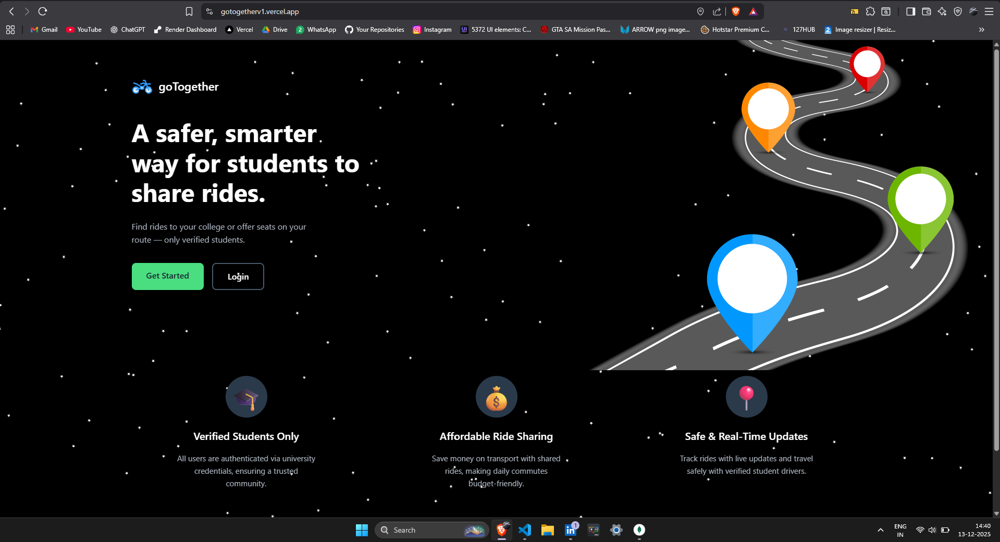
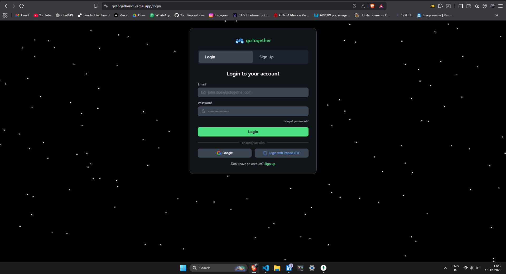
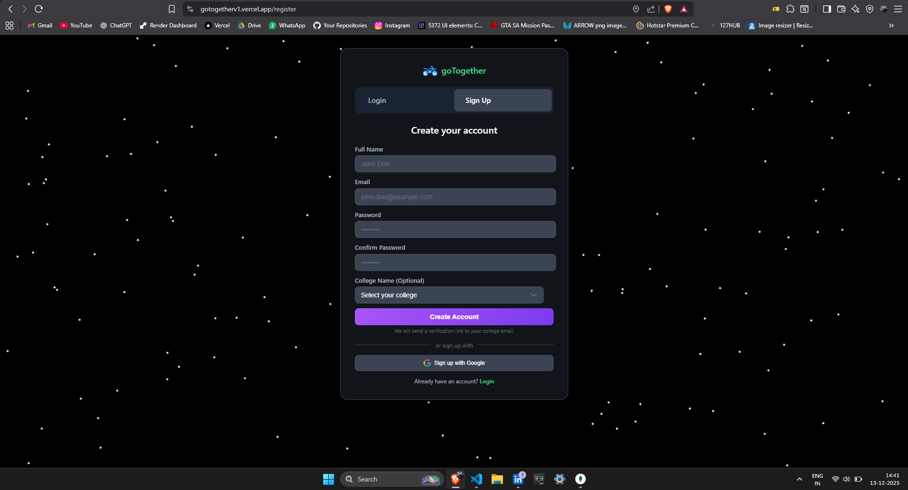
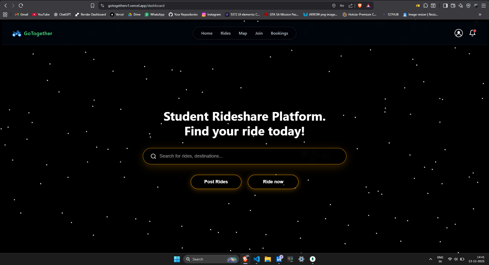
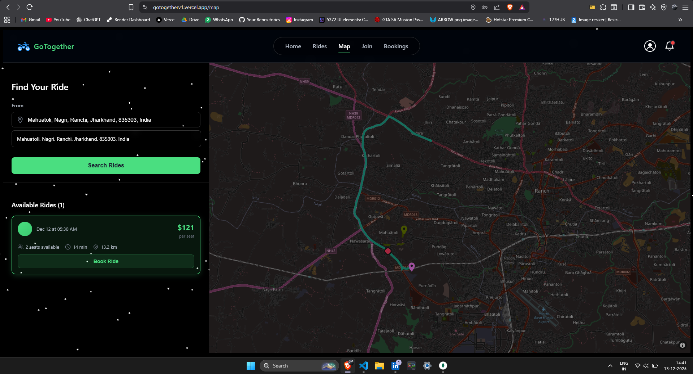
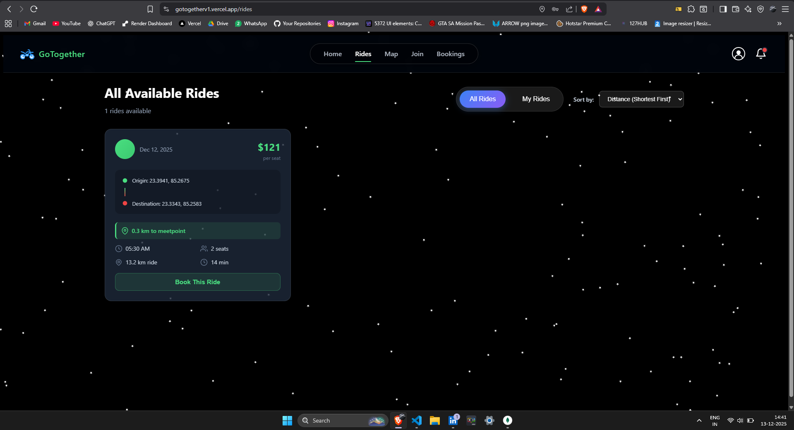
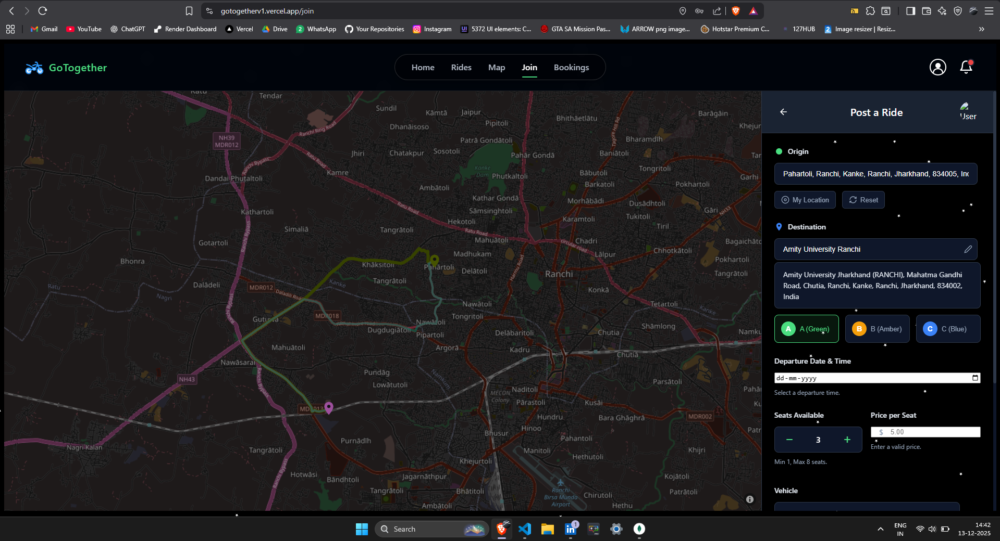
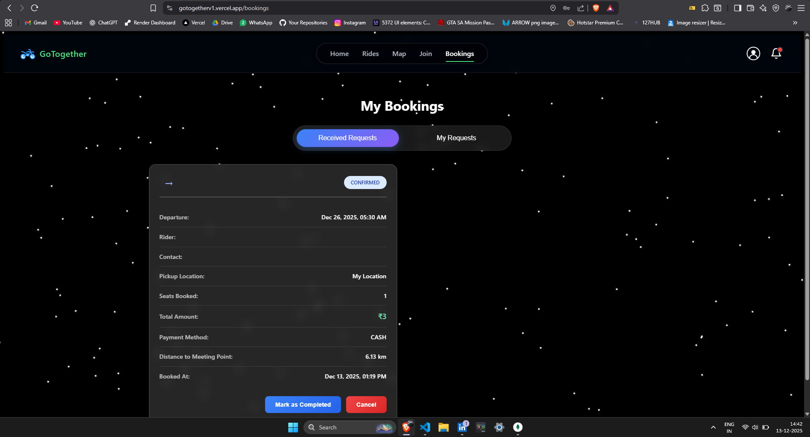
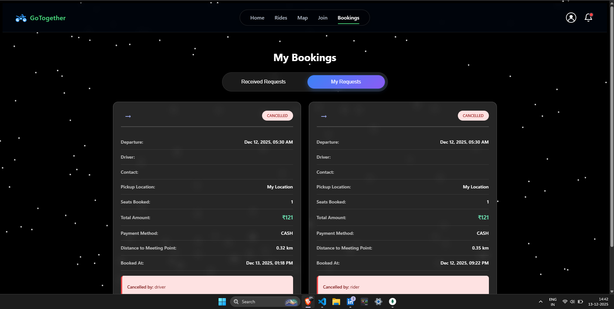

# 🚗 goTogether - Student Rideshare Platform

<div align="center">


**A modern full-stack rideshare platform built for students**

[](https://gotogetherv1.vercel.app)
[](./frontend)
[](./backend)
[](https://www.mongodb.com/)

</div>

---

## 📋 Table of Contents

- [About](#-about)
- [Features](#-features)
- [Tech Stack](#-tech-stack)
- [Screenshots](#-screenshots)
- [Getting Started](#-getting-started)
- [Environment Variables](#-environment-variables)
- [Project Structure](#-project-structure)
- [API Overview](#-api-overview)
- [Realtime Chat (Socket.IO)](#-realtime-chat-socketio)
- [Deployment](#-deployment)
- [Contributing](#-contributing)
- [License](#-license)
- [Team](#-team)
- [Support](#-support)

---

## 🎯 About

**goTogether** helps students share rides by connecting drivers and riders through map-based discovery, booking workflows, and live in-app chat.

### Why goTogether?

- 💰 **Save Money** - Share travel costs with fellow students
- 🌍 **Eco-Friendly** - Fewer vehicles and reduced emissions
- 🤝 **Build Community** - Connect students from nearby routes
- 🔒 **Secure Access** - JWT-protected user sessions
- 📱 **Simple UX** - Responsive UI with map-driven interactions

---

## ✨ Features

### 🔐 Authentication & Profile
- Register and login with JWT
- Token verification endpoint for session restore
- Protected frontend routes
- Profile update support

### 🗺️ Mapping & Geospatial
- Interactive maps with **MapLibre GL**
- Nominatim-powered place search/autocomplete
- Route generation through **OpenRouteService**
- GeoJSON storage (`Point`, `LineString`, `Polygon`) in MongoDB
- Proximity ride search via geospatial queries

### 🚗 Ride Management
- Post rides with origin, destination, date/time, seats, and pricing
- Auto-fetch and store route geometry + simplified route + bounding box
- Browse rides with pagination
- Filter by departure date
- “My Rides” view for posted rides

### 📱 Booking System
- Create bookings with seat validation
- Prevent self-booking and duplicate active booking
- Booking lifecycle: **pending → confirmed → completed**
- Cancellation flow with cancellation metadata
- Rider rating/review after completion
- Payment metadata (`cash`, `card`, `upi`, `wallet`)

### 💬 Realtime Chat
- Booking-specific chat threads
- Socket room join/leave per booking
- Live message delivery
- Typing indicators
- Read status updates and unread counters

### 🎨 UI/UX
- Dark, modern visual style
- Responsive layouts for mobile and desktop
- Loading states and status-aware UI feedback

---

## 🛠️ Tech Stack

### Frontend
- **React:** 19
- **Language:** TypeScript
- **Build Tool:** Vite
- **Routing:** react-router-dom (v7)
- **Maps:** MapLibre GL JS
- **HTTP:** Axios + Fetch
- **Realtime:** socket.io-client

### Backend
- **Runtime:** Node.js
- **Framework:** Express
- **Database:** MongoDB + Mongoose
- **Auth:** JWT + bcryptjs
- **Realtime:** Socket.IO
- **Geospatial Utilities:** Turf (`@turf/*`)

### Dev Utilities
- **Concurrency:** concurrently (root script)
- **Backend Dev Server:** nodemon

---

## 📸 Screenshots

### Landing & Auth




### Main App





### Bookings



### Mobile
<div align="center">

</div>

---

## 🚀 Getting Started

### Prerequisites

- Node.js (18+ recommended)
- npm
- MongoDB (local or Atlas)
- OpenRouteService API key

### Installation

1. **Clone repository**
	 ```bash
	 git clone https://github.com/amansharma1916/goTogether.git
	 cd goTogether
	 ```

2. **Install dependencies**
	 ```bash
	 npm install
	 npm install --prefix backend
	 npm install --prefix frontend
	 ```

3. **Create environment files**
	 - `backend/.env`
	 - `frontend/.env`

4. **Run app (frontend + backend together)**
	 ```bash
	 npm run app
	 ```

### Run separately

```bash
# terminal 1
cd backend
npm start

# terminal 2
cd frontend
npm run dev
```

### Local URLs

- Frontend: `http://localhost:5173`
- Backend: `http://localhost:5000`

---

## 🔧 Environment Variables

### Backend `.env`

```env
PORT=5000
MONGODB_URI=mongodb://localhost:27017/gotogether
JWT_SECRET=your_super_secret_jwt_key_here
FRONTEND_URL=http://localhost:5173
ORS_API_KEY=your_openrouteservice_api_key
NODE_ENV=development
```

### Frontend `.env`

```env
VITE_API_URL=http://localhost:5000
VITE_ORS_API_KEY=your_openrouteservice_api_key
```

---

## 📁 Project Structure

```text
goTogether/
├── backend/
│   ├── Auth/Routes/               # auth routes
│   ├── controllers/               # auth/ride/booking/message controllers
│   ├── DB/Schema/                 # Mongoose schemas
│   ├── middleware/                # JWT + socket auth middleware
│   ├── routes/                    # ride/booking/message routes
│   ├── socket/                    # Socket.IO events
│   └── server.js                  # backend entry point
│
├── frontend/
│   ├── src/components/Default/    # public pages
│   ├── src/components/User/       # protected user pages
│   ├── src/context/               # auth/chat/global state
│   ├── src/services/              # API + socket services
│   ├── src/Styles/                # CSS files
│   └── src/App.tsx                # app routes
│
├── screenshots/
├── package.json                   # root script: npm run app
└── README.md
```

---

## 📚 API Overview

Base URL: `http://localhost:5000/api`

### Auth

#### Register
```http
POST /api/auth/register
Content-Type: application/json

{
	"fullname": "John Doe",
	"email": "john@example.com",
	"password": "SecurePass123",
	"college": "Amity University"
}
```

#### Login
```http
POST /api/auth/login
Content-Type: application/json

{
	"email": "john@example.com",
	"password": "SecurePass123"
}
```

#### Verify token
```http
GET /api/auth/verify
Authorization: Bearer <token>
```

### Rides

- `POST /api/rides` (auth)
- `GET /api/rides`
- `POST /api/rides/search`
- `GET /api/rides/my-rides` (auth)
- `GET /api/rides/:id`

#### Search rides by proximity
```http
POST /api/rides/search
Content-Type: application/json

{
	"pickup": {
		"lat": 23.334284,
		"lng": 85.258330
	},
	"radiusMeters": 800,
	"timeWindow": {
		"from": "2026-02-23T08:00:00.000Z",
		"to": "2026-02-23T20:00:00.000Z"
	},
	"userId": "optional_user_id"
}
```

### Bookings

- `POST /api/bookings` (auth)
- `GET /api/bookings/my-bookings` (auth)
- `GET /api/bookings/received` (auth)
- `GET /api/bookings/ride/:rideId`
- `GET /api/bookings/:id` (auth)
- `PATCH /api/bookings/:id/confirm` (auth)
- `PATCH /api/bookings/:id/cancel` (auth)
- `PATCH /api/bookings/:id/complete` (auth)
- `PATCH /api/bookings/:id/rate` (auth)
- `PATCH /api/bookings/:id/payment` (auth)
- `PATCH /api/bookings/:id/status` (auth)

#### Create booking
```http
POST /api/bookings
Authorization: Bearer <token>
Content-Type: application/json

{
	"rideId": "ride_id_here",
	"seatsBooked": 1,
	"pickupLocation": {
		"lat": 23.340000,
		"lng": 85.280000
	},
	"pickupLocationName": "Near College Gate",
	"meetingPoint": {
		"lat": 23.335000,
		"lng": 85.270000
	},
	"distanceToMeetingPoint": 1200,
	"riderNotes": "Call when near",
	"paymentMethod": "upi"
}
```

### Messages

- `POST /api/messages/send` (auth)
- `GET /api/messages/history/:bookingId` (auth)
- `PATCH /api/messages/:bookingId/mark-read` (auth)
- `GET /api/messages/unread/count` (auth)
- `DELETE /api/messages/:messageId` (auth)

For expanded backend details, see [backend/API_DOCUMENTATION.md](./backend/API_DOCUMENTATION.md).

---

## 🔌 Realtime Chat (Socket.IO)

The backend Socket.IO server runs on the same host/port as Express.

### Auth
- Client sends JWT in `socket.auth.token`

### Implemented events
- `join_room`, `room_joined`, `user_joined`
- `send_message`, `new_message`, `message_sent`
- `typing`, `stop_typing`, `user_typing`, `user_stopped_typing`
- `mark_read`, `message_read`
- `leave_room`, `user_left`, `user_disconnected`

---

## 🌐 Deployment

### Frontend (Vercel)

- Root directory: `frontend`
- `frontend/vercel.json` already includes SPA rewrite to `index.html`
- Set env vars:
	- `VITE_API_URL`
	- `VITE_ORS_API_KEY`

### Backend (Render / Railway / Heroku-style hosts)

- Deploy `backend` service
- Ensure WebSocket support is enabled
- Set env vars:
	- `PORT`
	- `MONGODB_URI`
	- `JWT_SECRET`
	- `FRONTEND_URL`
	- `ORS_API_KEY`
	- `NODE_ENV=production`

### Database (MongoDB Atlas)

1. Create cluster
2. Create database user
3. Whitelist IP/network
4. Use Atlas URI in `MONGODB_URI`

---

## 🤝 Contributing

Contributions are welcome.

1. Fork the repository
2. Create a feature branch (`git checkout -b feature/AmazingFeature`)
3. Commit changes (`git commit -m "Add some AmazingFeature"`)
4. Push branch (`git push origin feature/AmazingFeature`)
5. Open a Pull Request

---

## 📝 License

This project is maintained by [@amansharma1916](https://github.com/amansharma1916).

---

## 👥 Team

**Developer:** Aman Sharma

- GitHub: [@amansharma1916](https://github.com/amansharma1916)
- LinkedIn: [www.linkedin.com/in/amansharma1916](https://www.linkedin.com/in/amansharma1916)
- Email: amansharmayt19@gmail.com

---

## 📞 Support

- Open an issue: [GitHub Issues](https://github.com/amansharma1916/goTogether/issues)
- Email: amansharmayt19@gmail.com

---

<div align="center">

**Made with ❤️ for Students by Students**

⭐ Star this repo if you find it useful!

[Live Demo](https://gotogetherv1.vercel.app) • [Report Bug](https://github.com/amansharma1916/goTogether/issues) • [Request Feature](https://github.com/amansharma1916/goTogether/issues)

</div>
